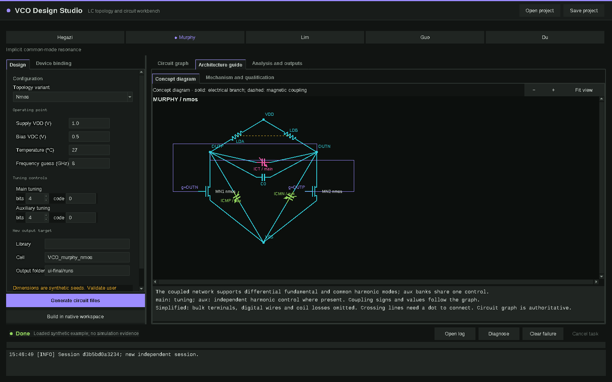
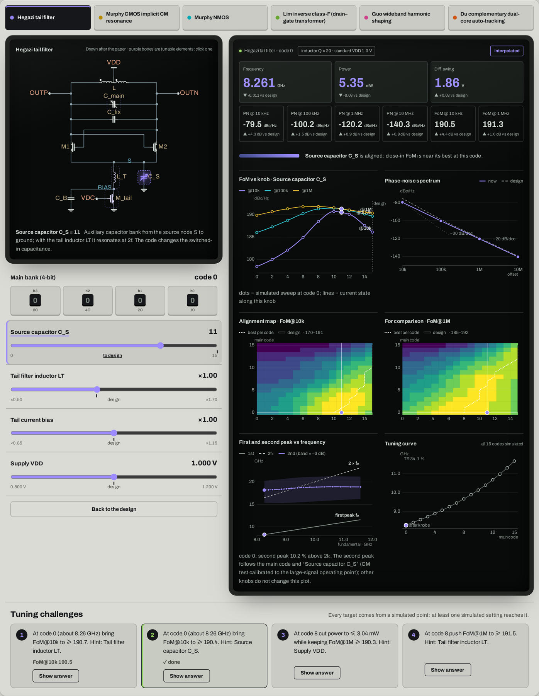
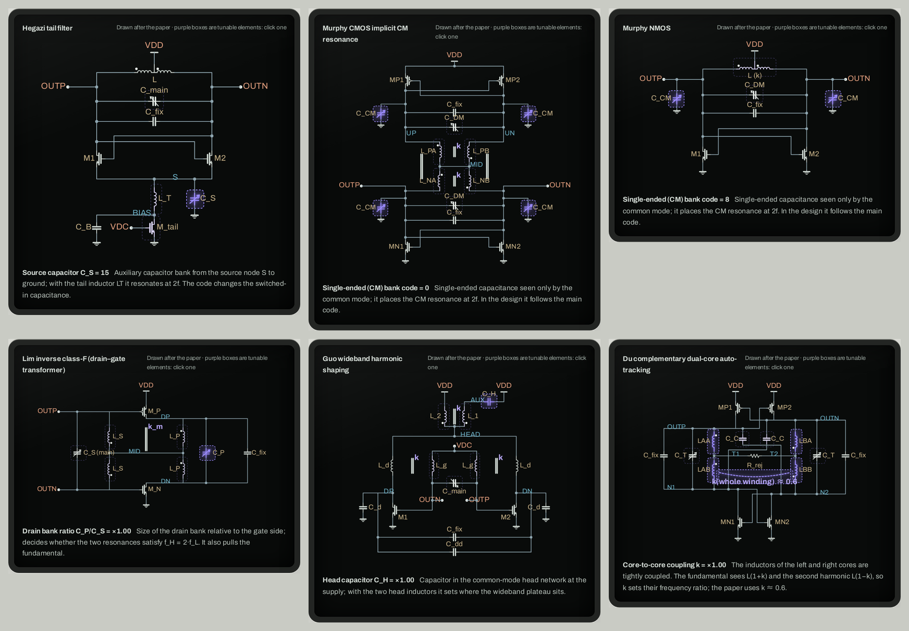
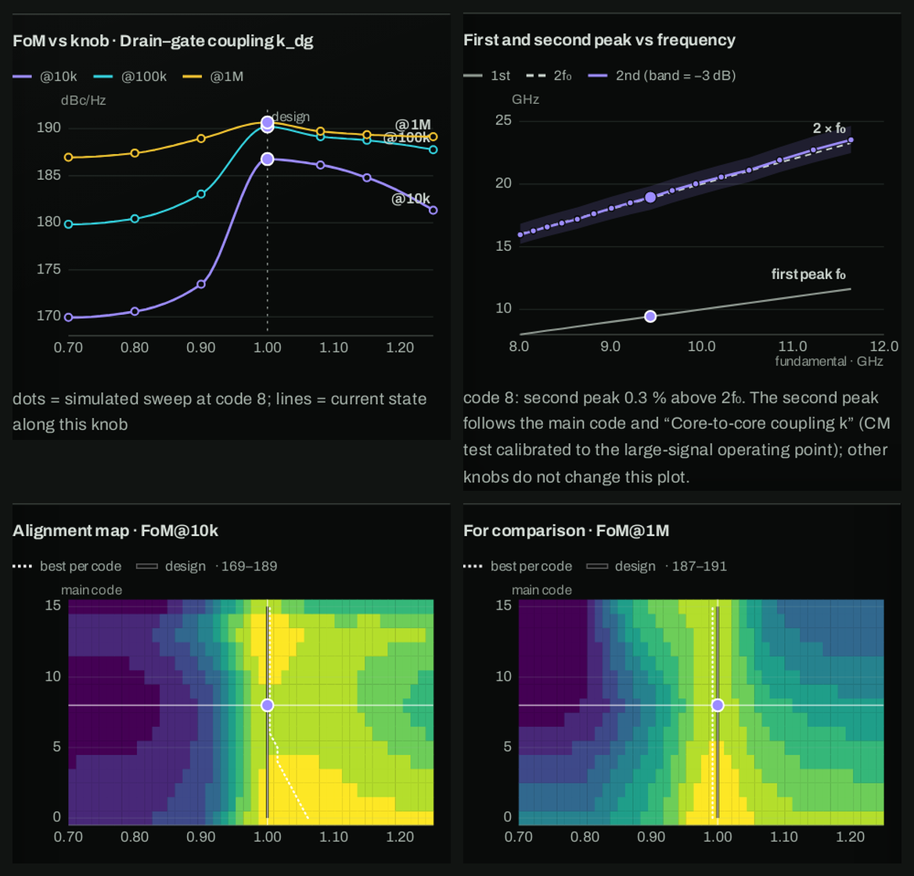
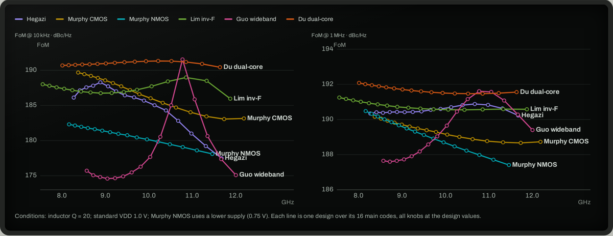
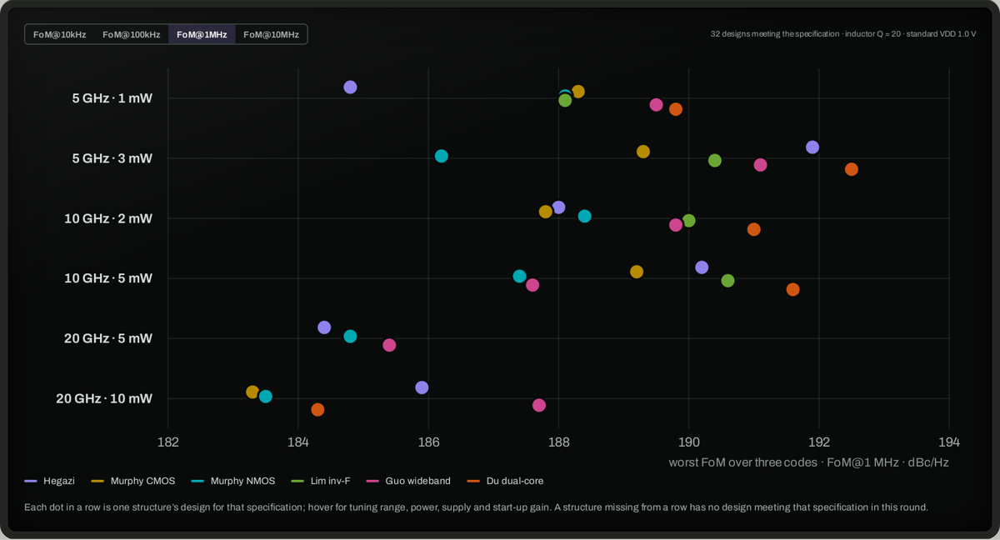
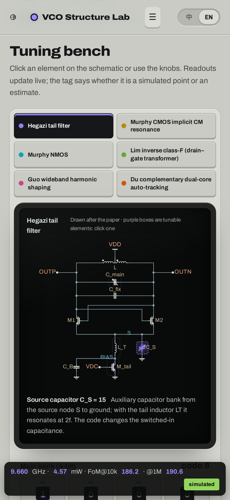

[简体中文](README.zh-CN.md)

# VCO Design Studio

An LC VCO topology and circuit-generation workbench for engineers and agents.

> **Try the structures first:** compare and tune all five in the browser in the [VCO Structure Lab](https://rf-fieldwork.pages.dev/vco-lab/?lang=en).



## Try every structure online: VCO Structure Lab

**Compare the five structures and tune them yourself in the browser — no install, no Cadence:**
**https://rf-fieldwork.pages.dev/vco-lab/?lang=en**

The lab puts one design of each structure on a tuning bench, backed by more than 400 harmonic-balance and
phase-noise simulations (65 nm CMOS, inductor Q = 20). Each structure shows only the knobs it really has.

[](https://rf-fieldwork.pages.dev/vco-lab/?lang=en)

- **Click an element on the schematic** (drawn after the paper and checked against the simulated netlist) to pick its
  knob: 4-bit capacitor bank, source capacitor, tail inductor, transformer coupling, drain/gate banks, head network,
  cross capacitor, supply.
- **Watch the effect live**: phase-noise spectrum, FoM at 10 kHz / 100 kHz / 1 MHz, alignment maps (code × knob) and
  the first and second resonance vs frequency. Every readout says whether it is a simulated point or an
  interpolation.
- **Tuning challenges** with a "Show answer" button, a six-design comparison and a performance survey across
  5 / 10 / 20 GHz targets.

| Six structures, one bench | What a knob does, across codes |
|---|---|
| [](https://rf-fieldwork.pages.dev/vco-lab/?lang=en) | [](https://rf-fieldwork.pages.dev/vco-lab/?lang=en) |
| **Six designs side by side** | **Which structure fits which target** |
| [](https://rf-fieldwork.pages.dev/vco-lab/?lang=en) | [](https://rf-fieldwork.pages.dev/vco-lab/?lang=en) |

It also works on a phone:



## What it does

- Browse five topology families and eight variants, with hierarchical circuit graphs and concept diagrams.
- Edit operating conditions and physical tuning controls; keep project and binding JSON files separate.
- Generate Spectre circuit/testbench files and immutable manifests from one electrical graph.
- Export native OA build scripts using an explicit device binding and workspace. The export packages each design into a reusable hierarchy (inductor, gm core, bias, capacitor arrays, units, inverter) with drawn symbols; with a user-provided structure pack the top level is laid out like the source paper figure, otherwise it is derived and laid out automatically. The packaged netlist is checked to be identical to the electrical graph.
- Show a paper-style topology drawing (from a structure pack) whose labels are the generated schematic instance paths, next to the citation and figure location of the source paper.
- Drive bounded design flows, evidence checks and qualification stages through the CLI.
- Supply nine agent workflow skills under `skills/`, with generic knowledge cards and small analysis helpers.

## Requirements

Python **3.11+**, Tk **8.6** for the desktop UI, and NumPy. The vendored theme also supports Tk 8.5; the application requires Python 3.11+. No additional GUI framework is used. Linux is the tested platform.

Catalog browsing, graph inspection and example generation work without Cadence. Native discovery/build and real simulation require your own compatible Cadence/Spectre installation, device libraries, models and license environment. Optional external analysis tools must be configured separately in a site profile; they are not bundled.

## Install / quick start

From a downloaded or cloned repository:

```sh
python3.11 -m pip install -r requirements.txt
export VCO_STUDIO_PYTHON="$(command -v python3.11)"
./launch catalog
./launch gui --runtime ../vco-runtime
```

Choose **Load example**, inspect the graph and click **Generate circuit files**. This writes a new design under the selected runtime directory; it does not run a simulator. The example has fictional device names and geometry. Its placeholder include defines no working semiconductor models.

The same example from the CLI:

```sh
./launch project murphy --variant nmos --binding demo_a --output ../example-project.json
./launch generate ../example-project.json --output ../example-generated
```

`data/baselines/class_b/` contains rewritten **synthetic examples** (`provenance.kind: synthetic_example`), not measured circuits or performance references. Use your own measurements for comparisons.

Output directories must be new or empty. Keep runtime outputs outside the program directory.

## Using with Cadence

Copy `examples/bindings/demo_a.json` to your own binding file and replace its fictional masters, terminal maps, parameter maps, geometry seeds, limits and model includes with verified user data. Use `--binding /path/to/binding.json` when creating a project. The GUI also supports **Load binding** and workspace discovery.

Set `VCO_STUDIO_NATIVE_PROFILE` to a user JSON containing `virtuoso` and, if needed, `ocean`, `environment_script` and `runtime_root`. Set `VCO_SPECTRE` and optionally `VCO_CADENCE_ENV` for simulation. `VCO_SITE` selects an optional site JSON; `examples/site.example.json` documents the neutral shape. Named user bindings are registered in its `bindings` object. No machine profile or technology package is shipped. See [binding configuration](docs/BINDINGS.md).

## CLI for agents

```sh
./launch --help
./launch describe hegazi --variant tail
./launch bindings
./launch diagnose
./launch spec-fields
./launch spec-check examples/spec.json
./launch kb check
./launch kb cards --stage selection --family murphy
./launch flow-next /path/to/task
./launch schematic check hegazi tail
./launch schematic preview hegazi tail --out /path/to/hegazi-preview
VCO_STUDIO_SCHEMATIC_DIR=examples/schematic-pack ./launch topology check class_b nmos
```

Read [the entry skill](skills/eda-vco-design/SKILL.md) before running a design flow. `./launch quickstart` describes the flow commands. Use your own measured evidence; the release includes no measured lookup table or ranking. Empty evidence remains unknown. Solver-dependent commands are documented separately from the offline quick start.

## Integrations

Tank Scan Lab, Z11 and an **external circuit optimizer** are optional external tools, supplied and configured by the user; none is bundled or required for offline browsing/generation. Set their compatible source roots under `tools.caplab`, `tools.z11` and `tools.optimizer` in the site JSON selected by `VCO_SITE`.

- Tank Scan Lab (formerly Cap Array Lab) postprocesses measured two-port Y matrices and exports workbooks. Studio's `bank-ac` performs the solver-based AC measurement; a passive export alone is not measured data.
- Z11 analyzes a static passive RLC/mutual-inductance projection, not the full active oscillator or its phase noise.
- The external circuit optimizer requires compatible `circuit_optimizer` modules and an explicit evaluator with status, feasibility, violations and evidence. A search result is electrically qualified only by its evaluator measurements.

Use `./launch site` to inspect configured tool roots. Missing tools make their optional functions unavailable; they do not affect the offline quick start. See [configuration details](docs/BINDINGS.md) for tool paths and optional knowledge/evidence inputs.

## Limitations

Synthetic geometry is for software demonstration, with no startup, tuning-range, phase-noise, reliability or PVT guarantee. Concept diagrams omit some detail; the circuit graph is authoritative. Native coupled primitives currently require the `analogLib/ind` adapter. Alternate magnetic models need a validated adapter. External tool adapters require compatible user installations. Sparse representative controls do not establish full-band coverage. Layout handoff and verification scaffolds do not perform physical layout, DRC/LVS signoff or extraction. Real EDA execution has not been validated for this public release.

## Not included in this repository

The following are not part of this repository:

- Structure packs that lay the top level out like the source paper figure and provide the paper-style drawings. Only a textbook Class-B example pack ships, in `examples/schematic-pack/`.
- Device bindings for a real PDK. `examples/bindings/demo_a.json` is fictional; replace it with your own verified binding (see [docs/BINDINGS.md](docs/BINDINGS.md)).
- Knowledge, evidence and lookup data from real designs.
- The optional external tools (Tank Scan Lab, Z11, an external circuit optimizer) and your Cadence and Spectre environment.

If you need one of these, or an example for your setup, please open a [GitHub issue](https://github.com/chloeyntu-byte/vco-design-studio/issues); the maintainer will reply there.

## RF-FIELDWORK

- Lab home (all tools, narrated films and progress): https://rf-fieldwork.pages.dev/?lang=en
- This tool's page (with a narrated film): https://rf-fieldwork.pages.dev/vco/?lang=en
- VCO Structure Lab (tune the structures in the browser): https://rf-fieldwork.pages.dev/vco-lab/?lang=en

Other open-source tools:

- [Flux Studio](https://github.com/chloeyntu-byte/flux-studio): parametric RF passives, EMX sweeps, multi-objective search and SNPFit
- [Tank Scan Lab](https://github.com/chloeyntu-byte/tank-scan-lab): LC tank scans (f0, Rp, gm, startup margin, loss shares), capacitor-array C/Q and resonance
- [Layout 3D Viewer](https://github.com/chloeyntu-byte/layout-3d-viewer): read IC layouts in 3D, locate pins and trace connections
- [VCO ISF Explorer](https://github.com/chloeyntu-byte/vco-isf-explorer): ISF, flicker-noise up-conversion and phase-noise contributions
- [Crescendo](https://github.com/chloeyntu-byte/crescendo): automatic device-size optimization inside Cadence Maestro

## License

MIT. See [LICENSE](LICENSE).
