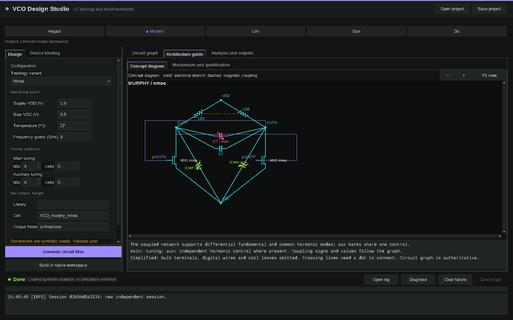

[简体中文](README.zh-CN.md)

# VCO Design Studio

An LC VCO topology and circuit-generation workbench for engineers and agents.



## What it does

- Browse five topology families and eight variants, with hierarchical circuit graphs and concept diagrams.
- Edit operating conditions and physical tuning controls; keep project and binding JSON files separate.
- Generate Spectre circuit/testbench files and immutable manifests from one electrical graph.
- Export native OA build scripts using an explicit device binding and workspace.
- Drive bounded design flows, evidence checks and qualification stages through the CLI.
- Supply nine agent workflow skills under `skills/`, with generic knowledge cards and small analysis helpers.

## Requirements

Python **3.11+**, Tk **8.6** for the desktop UI, and NumPy. The vendored theme also supports Tk 8.5; the application requires Python 3.11+. No additional GUI framework is used. Linux is the tested platform.

Catalog browsing, graph inspection and example generation work without Cadence. Native discovery/build and real simulation require your own compatible Cadence/Spectre installation, device libraries, models and license environment. Optional external analysis tools must be configured separately in a site profile; they are not bundled.

## Install / quick start

From a downloaded or cloned repository:

```sh
python3.11 -m pip install -r requirements.txt
export VCO_STUDIO_PYTHON="$(command -v python3.11)"
./launch catalog
./launch gui --runtime ../vco-runtime
```

Choose **Load example**, inspect the graph and click **Generate circuit files**. This writes a new design under the selected runtime directory; it does not run a simulator. The example has fictional device names and geometry. Its placeholder include defines no working semiconductor models.

The same example from the CLI:

```sh
./launch project murphy --variant nmos --binding demo_a --output ../example-project.json
./launch generate ../example-project.json --output ../example-generated
```

`data/baselines/class_b/` contains rewritten **synthetic examples** (`provenance.kind: synthetic_example`), not measured circuits or performance references. Use your own measurements for comparisons.

Output directories must be new or empty. Keep runtime outputs outside the program directory.

## Using with Cadence

Copy `examples/bindings/demo_a.json` to your own binding file and replace its fictional masters, terminal maps, parameter maps, geometry seeds, limits and model includes with verified user data. Use `--binding /path/to/binding.json` when creating a project. The GUI also supports **Load binding** and workspace discovery.

Set `VCO_STUDIO_NATIVE_PROFILE` to a user JSON containing `virtuoso` and, if needed, `ocean`, `environment_script` and `runtime_root`. Set `VCO_SPECTRE` and optionally `VCO_CADENCE_ENV` for simulation. `VCO_SITE` selects an optional site JSON; `examples/site.example.json` documents the neutral shape. Named user bindings are registered in its `bindings` object. No machine profile or technology package is shipped. See [binding configuration](docs/BINDINGS.md).

## CLI for agents

```sh
./launch --help
./launch describe hegazi --variant tail
./launch bindings
./launch diagnose
./launch spec-fields
./launch spec-check examples/spec.json
./launch kb check
./launch kb cards --stage selection --family murphy
./launch flow-next /path/to/task
```

Read [the entry skill](skills/eda-vco-design/SKILL.md) before running a design flow. `./launch quickstart` describes the flow commands. Use your own measured evidence; the release includes no measured lookup table or ranking. Empty evidence remains unknown. Solver-dependent commands are documented separately from the offline quick start.

## Integrations

Cap Array Lab, Z11 and an **external circuit optimizer** are optional external tools, supplied and configured by the user; none is bundled or required for offline browsing/generation. Set their compatible source roots under `tools.caplab`, `tools.z11` and `tools.optimizer` in the site JSON selected by `VCO_SITE`.

- Cap Array Lab postprocesses measured two-port Y matrices and exports workbooks. Studio's `bank-ac` performs the solver-based AC measurement; a passive export alone is not measured data.
- Z11 analyzes a static passive RLC/mutual-inductance projection, not the full active oscillator or its phase noise.
- The external circuit optimizer requires compatible `circuit_optimizer` modules and an explicit evaluator with status, feasibility, violations and evidence. A search result is electrically qualified only by its evaluator measurements.

Use `./launch site` to inspect configured tool roots. Missing tools make their optional functions unavailable; they do not affect the offline quick start. See [configuration details](docs/BINDINGS.md) for tool paths and optional knowledge/evidence inputs.

## Limitations

Synthetic geometry is for software demonstration, with no startup, tuning-range, phase-noise, reliability or PVT guarantee. Concept diagrams omit some detail; the circuit graph is authoritative. Native coupled primitives currently require the `analogLib/ind` adapter. Alternate magnetic models need a validated adapter. External tool adapters require compatible user installations. Sparse representative controls do not establish full-band coverage. Layout handoff and verification scaffolds do not perform physical layout, DRC/LVS signoff or extraction. Real EDA execution has not been validated for this public release.

## License

MIT. See [LICENSE](LICENSE).
