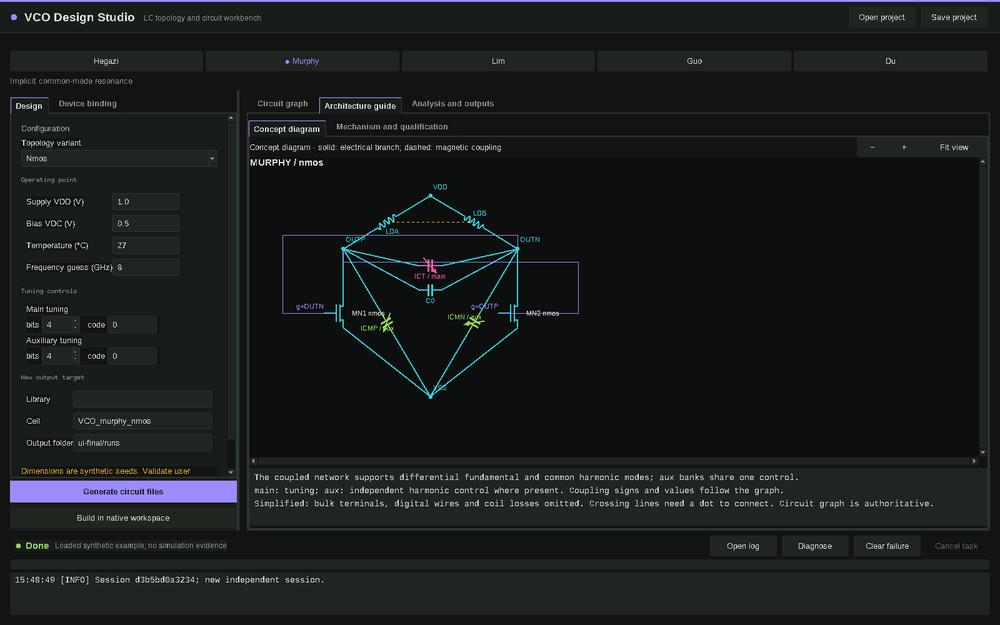

[English](README.md)

# VCO Design Studio

面向工程师与 Agent 的 LC VCO 结构浏览和电路生成工作台。



## 功能

- 浏览五个结构家族、八个变体，查看分层连接图和概念图。
- 编辑工作条件与实际调谐控制；项目与器件绑定分别保存为 JSON。
- 从统一电气图生成 Spectre 电路、测试台和不可变清单。
- 通过明确的器件绑定和工作区导出原生 OA 构建脚本。
- 通过 CLI 驱动有预算的设计流程、证据检查和资格验证阶段。
- `skills/` 提供九份 Agent 工作流说明，并附通用知识卡与小型分析脚本。

## 环境要求

需要 **Python 3.11+**、桌面界面所需的 **Tk 8.6** 和 NumPy。内置主题兼容 Tk 8.5，但应用本身仍要求 Python 3.11+。无需其他 GUI 框架。已测试平台为 Linux。

结构浏览、连接图和示例生成无需 Cadence。原生器件发现、构建及真实仿真需要用户自己的兼容 Cadence/Spectre 安装、器件库、模型和许可环境。可选外部分析工具须在 site 配置中单独指定，仓库不包含这些工具。

## 安装与快速开始

下载或克隆仓库后执行：

```sh
python3.11 -m pip install -r requirements.txt
export VCO_STUDIO_PYTHON="$(command -v python3.11)"
./launch catalog
./launch gui --runtime ../vco-runtime
```

点击 **Load example** 查看连接图，再点击 **Generate circuit files**。程序会在所选运行目录下创建电路文件，不启动仿真。示例中的器件名和尺寸为虚构数据；占位 include 不定义可工作的半导体模型。

也可使用 CLI：

```sh
./launch project murphy --variant nmos --binding demo_a --output ../example-project.json
./launch generate ../example-project.json --output ../example-generated
```

输出目录须为新目录或空目录，运行产物须与程序目录分离。

## 配合 Cadence 使用

复制 `examples/bindings/demo_a.json` 到自己的绑定文件，将虚构 master、端子映射、参数映射、几何初值、尺寸范围和模型 include 替换为已核验的用户数据。创建项目时传入 `--binding /path/to/binding.json`；GUI 也支持 **Load binding** 和工作区发现。

用 `VCO_STUDIO_NATIVE_PROFILE` 指定用户 JSON，其中填写 `virtuoso`，按需填写 `ocean`、`environment_script` 和 `runtime_root`。真实仿真使用 `VCO_SPECTRE`，可选 `VCO_CADENCE_ENV`。`VCO_SITE` 指向可选 site JSON，中性格式见 `examples/site.example.json`；其 `bindings` 对象可注册用户绑定名。仓库不附机器 profile 或工艺包。详见[器件绑定配置](docs/BINDINGS.md)。

## Agent CLI

```sh
./launch --help
./launch describe hegazi --variant tail
./launch bindings
./launch diagnose
./launch spec-fields
./launch spec-check examples/spec.json
./launch kb check
./launch kb cards --stage selection --family murphy
./launch flow-next /path/to/task
```

开始设计流程前阅读[入口技能](skills/eda-vco-design/SKILL.md)。`./launch quickstart` 介绍流程命令。用户必须提供自己的实测证据；本版本不附实测查找表或性能排名，空证据返回未知。需要求解器的命令与离线快速开始分开说明。

## 限制

合成尺寸仅用于软件演示，不保证起振、调谐范围、相噪、可靠性或 PVT。概念图省略部分细节，电气连接以 circuit graph 为准。原生耦合电感目前要求 `analogLib/ind` 适配器，其他磁模型须增加已验证适配器。外部工具适配器依赖用户的兼容安装。稀疏代表码不能证明全频段覆盖。版图交接与验证脚手架不执行物理版图、DRC/LVS 签核或提取。本次公开版本未验证真实 EDA 执行。

## 许可

MIT，见 [LICENSE](LICENSE)。
